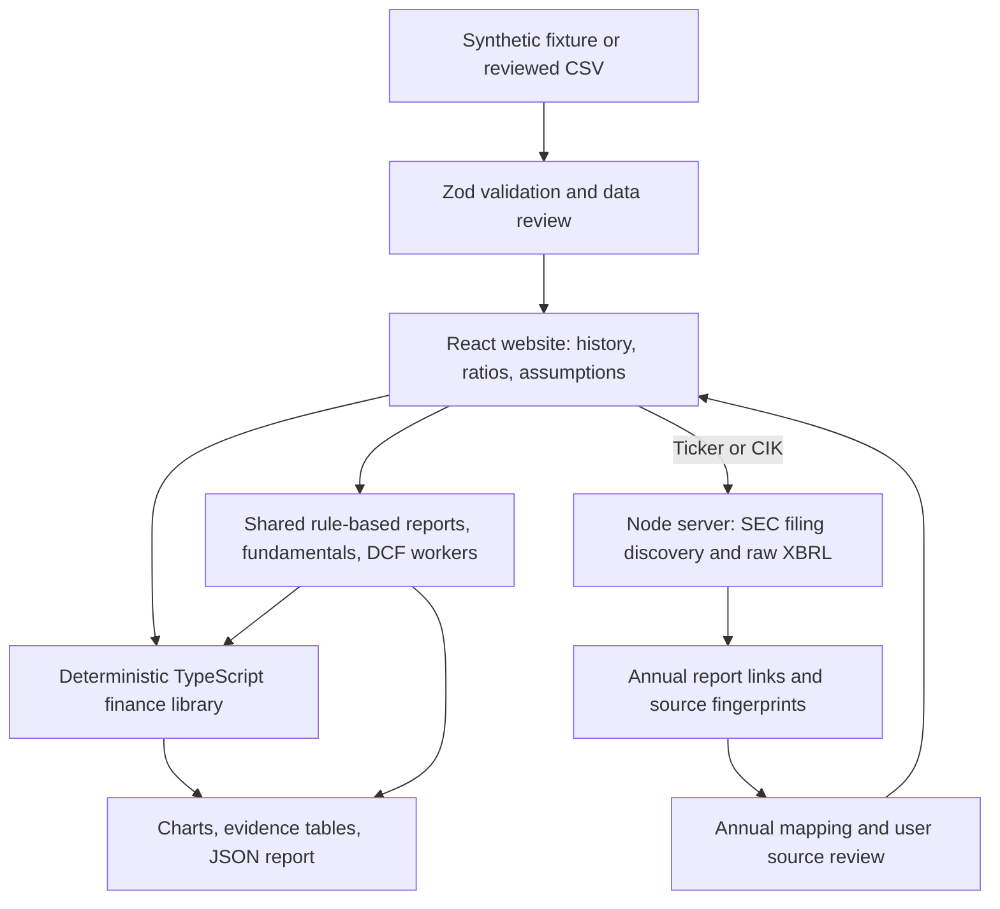

# Equity Researcher: architecture and interview guide

Updated: 9 November 2026 (Asia/Calcutta).

**Status:** website v0.5.0 has free, deterministic reports/fundamentals/DCF workers, local private-company research, SEC mapping/source review, and portable Save/Open sessions. The user explicitly rejected paid APIs and model keys on 7 November; the OpenAI integration was removed. Live SEC retrieval works: 96 populated figures across Microsoft and Apple matched original statements. Historical review is separate from DCF suitability; reviewed missing inputs and written forecast rationale are required before real-company valuation. See [financial validation](financial-validation.md). Excel/PDF, price feeds and hosted deployment remain later work. See [workflow details](normalization-and-agents.md) and [sessions](sessions.md).

## 1. What we are building

A research workbench that answers four questions:

1. What has the business earned, generated in cash, and borrowed over the last 3–7 completed fiscal years?
2. How have profitability, growth, liquidity, leverage, and capital efficiency changed?
3. What could the operating business be worth under explicit assumptions about its future cash flows and risk?
4. Which source documents, calculations, and assumptions support each conclusion?

The result is a research report with historical statements, ratios, charts, evidence links, an editable five-year forecast, bull/base/bear valuations, and a WACC versus terminal-growth sensitivity table. It should explain uncertainty and weaknesses as clearly as strengths. It should not imply that an estimated value is an objective price target or guarantee of returns.

The user selected **US-listed companies first**, using SEC filings. The initial financial-model scope is non-financial operating companies. This choice gives us a reliable, explainable starting point from a structured official source. Indian filings require a separate adapter and Ind AS mapping; they are not silently treated as US GAAP data.

The working private-company path uses a fixed CSV template with a review step and explicit field definitions. Excel support and flexible column mapping follow later. Add native-text PDF extraction only with a review screen before calculations; scanned-document OCR is a later capability. Uploading a document does not establish that its extracted numbers are correct or that its accounts are audited.

### Scope boundaries

- Request five completed fiscal years by default; allow three through seven. The cap applies to distinct fiscal periods displayed and analyzed, not the count of documents downloaded to verify those periods.
- Fewer than three comparable years produces an explicitly incomplete-history view. Do not label it a full research report. Historical rows may still be inspected; the initial full valuation workflow requires the history gate to pass.
- Begin with non-financial businesses with interpretable operating earnings and cash flows. Banks and insurers need different capital, leverage, and valuation models; REIT-specific FFO/AFFO analysis also belongs in a later sector module.
- A company with negative or unstable operating cash generation can still have historical analysis. Do not force the default DCF assumptions onto it; require a documented path to sustainable cash flow or withhold a valuation conclusion.
- No live trading, order placement, real-time market feeds, automated buy/sell recommendations, or automatic private-data sharing.
- Peer multiples, segment forecasts, detailed working-capital schedules, quarterly updates, and OCR are later extensions. They do not block a useful first release.

## 2. Architecture: one application, three rule-based workers

The working first release is a **React + TypeScript website built with Vite**, with financial formulas in a separate, framework-independent TypeScript module. Recharts draws charts, Zod validates imported rows, and Papa Parse handles CSV syntax. Vitest tests the financial engine; Playwright tests the browser flows; axe checks automated accessibility rules.

Financial calculations and private CSV processing happen in the browser. Public SEC lookup runs through the Node server. A small static website is enough to inspect synthetic financials or a reviewed CSV and calculate ratios and DCF outputs. Private uploads are not sent to a server or external model. Save/Open session retains inputs, assumptions, selected history and scenario in a local versioned file. Private inputs never leave the browser. There is no automatic persistence or database; refreshing without saving still loses work. Research-result exports are a separate format.

One language covers the interface and calculations, which simplifies explaining the flow in an interview. SEC retrieval now uses a small Node/TypeScript server boundary; public-source requests use that boundary while the financial and research libraries remain reusable. No model credentials are required. Never put API keys or other credentials in browser code or Vite public environment variables. A database is deferred until a concrete saved-research or shared-user requirement is implemented.

No initial need exists for microservices, a queue, Redis, Kubernetes, a vector database, or an agent framework. The earlier Python/Streamlit design was superseded by the user’s preference for a website; its financial principles remain intact.



The three roles run in a fixed sequence through shared TypeScript functions. Reports summarize source identity and coverage, fundamentals compute ratios, and DCF computes scenarios from reviewed assumptions. Public SEC data is fetched and validated on the server; sample/private research runs in the browser. Every role returns all its evidence and an audit trace.

| Agent / worker | Fixed responsibility | Hard boundary |
| --- | --- | --- |
| Reports | Inspect retrieved identity, selected filings and data completeness | No fabricated facts, arbitrary external URLs or automatic approval of unresolved mappings. |
| Fundamentals | Compute ratios, formulas, input references and missing-input reasons | No unsupported causal claims or invented numbers. |
| DCF | Compute scenarios and terminal concentration or report a blocker | No hidden changes to assumptions or bypassing valuation gates. |

These are **rule-based workers**, not autonomous LLM agents. This distinction matters for the CV: the project demonstrates modular financial analysis and data engineering, not model-driven autonomy. No agent framework, paid model, model download, token budget or inference API is needed. A fixed workflow is sufficient for this scope and easier to reproduce and explain.

Local software use and SEC data access require no paid API. Hosted deployment is not part of this milestone and has not been purchased. No paid provider is used as a fallback when SEC access fails. Private files and local research remain browser-only.

### Current module layout

```text
server/
  index.ts                 # Server startup and environment-only SEC contact
  app.ts                   # Public SEC/research API and production static website
  normalize.ts             # Annual contexts, mapping, provenance and review
  research-service.ts      # Source revalidation and request contract
  sec-client.ts            # HTTPS proxy, pacing, bounded cache, retries
  sec-service.ts           # Identity, filing history, raw-facts evidence
scripts/
  dev.mjs                  # Development API + Vite process lifecycle
  check-sec.mjs            # Opt-in live retrieval check after configuration
src/
  App.tsx                   # Workspace state, navigation, report export
  components/
    Charts.tsx              # Historical and forecast charts
    Financials.tsx          # Statements and ratios
    Valuation.tsx           # Assumptions, scenarios, bridge, sensitivity
    UploadDialog.tsx        # CSV selection and review
    SecReportsDialog.tsx    # Filing discovery and candidate mapping
    FinancialReview.tsx     # Source review and explicit manual entries
    ResearchPanel.tsx       # Local/public research evidence and audit trails
    SessionDialog.tsx       # Local-file validation and restore confirmation
    Modal.tsx               # Native dialog and focus handling
  lib/
    types.ts                # Typed financial years, metrics, assumptions
    sample.ts               # Explicitly synthetic company and assumptions
    csv.ts                  # Schema, period/unit checks, file helpers
    finance.ts              # Pure ratios, FCFF, DCF, bridge calculations
    research.ts             # Three shared deterministic workers
    session.ts              # Versioned session schema and restore checks
    format.ts               # Display formatting only
  styles.css                # Responsive layout and accessible text palette
tests/
  unit/                     # Financial and import edge cases
  browser/                  # Real Chromium interactions and accessibility
```

The fixture includes 2018–2025 to support seven displayed annual periods plus an opening balance. Default history is 2021–2025. The extra opening year is not an eighth displayed analysis period. The first model’s public per-share example uses a synthetic current share count and synthetic reference price; it represents no actual listed issuer.

The SEC adapter and agent workflow pass offline evaluation; live Microsoft discovery, mapping review and selected-field reconciliation also passed on 9 November. A reviewed SEC mapping can feed the dashboard. A database, login system and public deployment remain unimplemented.

## 3. Data sourcing and evidence

### Public companies

For the implemented US adapter, resolve ticker/name to SEC CIK, then use submission metadata to identify annual reports and structured XBRL data for candidate financial facts. Use 10-K first. Add 20-F and foreign private issuer handling only after fiscal-period and IFRS mappings are covered. An annual report often contains multiple comparative years, so five historical years need not mean five distinct reports.

SEC Company Facts is a source of candidate facts, not a ready-made standardized financial statement. Similar concepts can have different tags; custom extension tags and consolidated-versus-segment contexts require reconciliation against the filing. Prefer consolidated statements. Keep the original filing reference with each accepted fact.

The implemented client uses HTTPS, a genuine configured identifying User-Agent, a bounded 15-minute in-memory cache, serialized requests at no more than two per second, and Retry-After/backoff with a shared cooldown. It respects the platform proxy without bypassing TLS checks. Original report HTML is linked, not parsed. The earlier developer-resource request was blocked; the supported proxy and conservative pacing remain in use. Do not scrape an aggregator to work around a denial.

Required destinations are `www.sec.gov` and `data.sec.gov`. No model-service destination is used. The earlier environment proxy failures were resolved when the user published the settings on 9 November. Genuine-contact live requests now pass; the contact remains private. The obsolete model secret, variable and domain are gone. No SEC API key is needed. See [SEC integration](sec-integration.md) and [original-statement verification](live-sec-validation.md). Draft saves still do not activate settings or publish.

### Private companies

The current CSV template includes currency, scale, fiscal-year dates, and income-statement, balance-sheet, and cash-flow inputs. Company name is entered in the review dialog. Headers are fixed; automatic column mapping is not implemented. Only USD millions and full January–December years are currently supported. Blank financial values remain unavailable. A user confirms the operating-company and common-shareholder scope before using the data. The file receives a SHA-256 fingerprint; inputs receive fiscal-year/field references. Uploaded accounts are not described as audited or independently verified. See `docs/csv-template.md` for the exact contract.

For PDFs, preserve page/table references and show extracted cells alongside their source. Ambiguous signs, unlabeled units, and missing cash-flow data require review. Do not infer a missing cash-flow statement from net income alone. Report limitations in the resulting analysis.

Private-company DCF initially reports enterprise/equity value. Per-share value requires a verified capitalization basis; a public-company stock price is not applicable. Do not apply arbitrary illiquidity, control, or size premiums without a separate methodology.

### Canonical data contract

SEC mappings now retain supported tags, original and normalized values, periods, accession links, filing dates, retrieval timestamp, source hash, mapping version, status and all candidate versions. Manual entries retain rationale and can be revised/cleared through Review mappings. A shared review module enforces browser/server agreement. Historical approval is separate from DCF suitability and the lease/accounting-scope note; neither bypasses missing investment/debt inputs. Exact page/table extraction and explicit scope automation remain future work. The broader target evidence contract includes: company ID; canonical metric; original label/tag; value; currency; scale; period start/end or balance-sheet date; duration versus instant type; statement scope; source URL/file identifier; accession/page/table where available; filing/publication date where available; retrieval date; and validation status. Keep reported and normalized values so sign/unit conversions remain inspectable.

Each calculated metric needs: formula/version, input fact IDs, value or unavailable reason, period, units, and warnings. Each assumption needs: value/unit, affected years, rationale, source or user input, and whether it is proposed or accepted.

Current JSON exports include the source dataset, upload hash where applicable, selected history, ratio formulas and input references, base/applied assumptions, approval status, calculation version, and valuation or blocking issue. Research exports also retain SEC candidates, workflow/calculation versions, tool traces and input hashes. Separate versioned session files preserve only inputs and settings: restore validates these and recalculates results, rather than trusting saved valuations or agent output.

### Validation gates

The working importer validates headers, numeric values, 3–8 rows, consecutive completed calendar years, USD millions, positive-outflow CapEx, cash versus current assets, and balance-sheet reconciliation when all required inputs exist. The SEC adapter now supports full non-calendar fiscal periods and retained comparative revisions. Detailed cash-movement reconciliation remains future work. The full target gates are:

1. Align annual durations and fiscal years; exclude quarterly and trailing-twelve-month facts from annual comparisons. Flag 52/53-week and shortened transition years.
2. Normalize currency and scale explicitly. Do not mix rupees, dollars, thousands, and millions. Initially require one reporting currency for a comparable series; flag currency changes for review instead of applying undocumented FX conversions.
3. Resolve duplicate/amended/restated values using a documented policy: default to the latest available accepted restatement per period and disclose it. Preserve superseded values. This creates a current-information analysis, not a point-in-time backtest.
4. Reconcile balance sheets and cash movements where the required line items exist. For a balance sheet, use an initial tolerance of the greater of one reported unit or 0.1% of assets; disclose this tolerance and refine it with fixtures. Cash reconciliation must account for FX and scope differences rather than assume every mismatch is a bad value.
5. Confirm CapEx, debt, cash, and share definitions; verify signs from source semantics rather than applying absolute values to every negative entry.
6. Identify missing or incompatible facts. Use unavailable-with-reason, never silent zero filling. Material unresolved issues block affected ratios or valuation, while valid unrelated metrics can still render.

Show factual statuses such as sourced, derived, user-entered, missing, and needs-review. Avoid a made-up aggregate confidence percentage or an unsupported overall stock score.

## 4. Fundamental analysis and financial definitions

The website shows revenue, operating profit, common-shareholder net income, CFO, CapEx, cash, debt, common equity, and supporting inputs. Twelve calculated metrics cover margins, liquidity, leverage, ROE, ROA, cash conversion, and cash flow after CapEx; revenue CAGR is also displayed. Clicking a ratio exposes its formula and fiscal-year input references. The ROIC definition below remains a design target; historical ROIC is not implemented because normalized taxes and excess-cash adjustments need stronger evidence.

| Topic | Initial calculation | Interpretation and guardrail |
| --- | --- | --- |
| Growth | Revenue YoY = current/prior − 1; CAGR = (last/first)^(1/intervals) − 1 | Three annual observations span two intervals. Conventional CAGR needs positive starting and ending values; do not disguise losses or sign changes as ordinary growth. |
| Margins | Gross profit/revenue; operating profit/revenue; net income/revenue | Require comparable scope and nonzero revenue. Gross profit and net income definitions must be visible. |
| ROE | Income attributable to common shareholders / average common equity | Use opening and closing equity. Nonpositive equity makes conventional interpretation unreliable; flag or suppress. |
| ROA | Net income / average total assets | Disclose the income scope. It is affected by financing and accounting policy. |
| ROIC | NOPAT / average invested capital | Default invested capital = interest-bearing debt + total equity including NCI − excess cash/non-operating investments. Identify excess cash explicitly; if only total cash is available, label that approximation. |
| Liquidity | Current assets/current liabilities; (cash + short-term investments + receivables)/current liabilities | Not universally useful across sectors; unavailable when the source does not classify current items consistently. |
| Leverage | Interest-bearing debt/common equity; net debt/EBITDA | Total liabilities are not debt. Nonpositive equity or EBITDA makes the respective multiple not meaningful. |
| Coverage | EBIT/gross interest expense | Net interest income is not a substitute for gross interest expense. Zero/missing expense is not silently converted into a reassuring ratio. |
| Cash generation | CFO − CapEx; CFO/net income | Call the first “cash flow after capital expenditure,” not unlevered FCFF. The second is not informative with nonpositive net income. |

EBITDA is EBIT plus depreciation and amortization only when those inputs can be reconciled; do not relabel every reported “adjusted EBITDA” as the same measure. Unavailable D&A means unavailable derived EBITDA. Reported operating profit may need an explicit reconciliation before using it as operating EBIT.

Calculate average-denominator ratios only with opening and closing balances. Fetch an extra opening balance as supporting input if available, without adding an eighth displayed fiscal year; otherwise the earliest affected ratio is unavailable. Do not quietly use a closing balance and call it an average.

Explain patterns without claiming unsupported causes: “operating margin fell from X to Y” is a calculation; “input-cost inflation caused it” requires evidence from filings. Compare trends over time first. Peer comparisons later require sector, geography, size, accounting, and date alignment. A low P/E alone does not establish undervaluation.

## 5. DCF: the smallest credible model

### Why FCFF and WACC?

Use free cash flow to the firm (FCFF) to value the operating business independently of its current financing mix, then bridge enterprise value to equity value. Discount FCFF at WACC because cash flows belong to both debt and equity capital providers. Discounting FCFF at cost of equity would mismatch the claim and the discount rate.

The initial model is an annual, five-year, unlevered DCF with year-end discounting and a perpetual-growth terminal value. It is a driver-based operating forecast, not a fully integrated three-statement model. It does not project a debt schedule, interest expense, cash balances, or a balancing equity account; label the forecast accordingly.

### Forecast drivers

- Revenue = prior revenue × (1 + growth assumption).
- EBIT = revenue × operating margin.
- NOPAT = EBIT × (1 − operating cash tax rate), within the supported tax treatment.
- D&A and CapEx = revenue × separately disclosed assumptions.
- Operating net working capital (NWC) = revenue × NWC/revenue assumption.
- Change in NWC = current NWC − previous NWC.
- **FCFF = NOPAT + D&A − CapEx − change in NWC.**

Define operating NWC from operating current assets excluding cash/non-operating investments, less operating current liabilities excluding financing debt. Identify the included accounts. Taxes, lease items, and other ambiguous balances require a consistent, disclosed treatment. Growth consumes cash when operating NWC rises; an increase in NWC therefore reduces FCFF.

Example: EBIT 100, operating tax rate 25%, D&A 10, CapEx 20, and an NWC increase of 5 give NOPAT 75 and FCFF **60**. CFO minus CapEx can differ because reported CFO can include interest/tax classifications and other cash-flow adjustments.

Historical medians/trends can seed a proposed assumption, but they are not facts about the future. In the current CSV flow, revenue growth is seeded from up to the latest five years and operating ratios from the latest year. Tax 25%, WACC 10%, and terminal growth 2.5% are clearly proposed inputs, not sourced estimates. Excess cash and additional claims/assets start at zero and must be reviewed. Missing operating inputs remain unavailable. Non-demo valuation requires a written rationale for forecast inputs, discount rate and bridge claims, and is explicitly as of the latest fiscal year-end. Private-company valuation is withheld until the user applies the reviewed inputs, and editing a base input requires review again. The synthetic demo starts with visibly illustrative assumptions. Use a stable mature-company fixture first. If loss carryforwards or a turnaround materially affect taxes, require an explicit tax schedule or mark the simple model unsuitable; do not grant automatic tax refunds on negative EBIT.

### Discount rate and terminal value

Use a user-entered, explained WACC first; provide an optional transparent helper:

`cost of equity = risk-free rate + levered beta × equity risk premium`

`WACC = E/(D+E) × cost of equity + D/(D+E) × pre-tax cost of debt × (1 − tax rate)`

Use market-value capital weights where possible. A book-debt approximation must be disclosed. The risk-free rate and nominal cash flows must be in the same currency; ERP, beta, capital weights, and debt cost need sources/as-of dates. A tax shield assumes usable tax deductions. Do not pretend CAPM inputs are known exactly or infer a private-company beta from nonexistent trading history.

`terminal value at year 5 = normalized year-6 FCFF / (WACC − g)`

`enterprise value = sum(FCFF_t / (1 + WACC)^t) + terminal value / (1 + WACC)^5`

Require `WACC > g`, a positive discount factor, and a defensible stable state. Never silently clamp invalid assumptions. Use perpetual growth consistent with the reporting currency and a mature business, supported by a cited economic rationale. A fixed universal 3% default would not be appropriate for every country or currency. The current USD teaching model bounds terminal growth to 0–6% as a model-domain guardrail, not a claim that every rate in that interval is economically reasonable; other cases need a different explicit model.

Do not multiply an abnormal year-five FCFF by `(1 + g)` and call it normalized. Project the year-six drivers explicitly and show their reinvestment requirements. As a terminal cross-check, under stable definitions `reinvestment rate = g / terminal ROIC`, and `FCFF = NOPAT × (1 − reinvestment rate)`. Reject assumptions that imply positive perpetual growth with no economic reinvestment, or negative reinvestment indefinitely at zero growth. At zero growth, implied terminal ROIC is left unavailable rather than misleadingly reported as zero. An exit-multiple cross-check can be added after peer comparability is implemented.

### From enterprise value to equity value

`equity value = enterprise value + excess cash + non-operating assets − debt − other senior claims − non-controlling interests`

Reconcile lease liabilities and lease expenses consistently. If leases are treated as financing claims, corresponding operating cash flows/earnings must be adjusted consistently; do not mechanically subtract lease debt while leaving all lease costs in the same operating forecast. The initial release should flag material unresolved lease treatment instead of claiming an adjusted valuation.

Use current diluted shares or a documented current dilution calculation for a public-company per-share estimate. Historical weighted-average EPS shares measure a different thing and must not silently replace current capitalization. Handle options, convertibles, and preferred claims consistently to avoid double counting. If material inputs cannot be reconciled, report enterprise value and withhold the unsupported per-share result.

Example: enterprise value 1,000 plus excess cash 50 minus debt 200, with no other claims, gives equity value 850. With 100 current diluted shares, estimated value is **8.50 per share**. A private-company enterprise value alone is not a share price.

For future public-company market comparisons, accept a user-entered price with currency and as-of date first. The current site only has a labelled synthetic price of USD 38.50 at the fixture’s FY2025 end; no editable market-price source is implemented. Display `(estimated per-share value / reference price) − 1` as scenario-implied difference, not an expected investment return. Add a licensed price-data adapter later. Align the valuation date and balance-sheet date, disclose stale inputs, and account for material intervening events.

### Scenarios and charts

- Historical revenue/profit and margin charts with clear units and fiscal-year labels.
- Debt, cash, cash-flow-after-CapEx, and selected return ratios over time.
- Forecast FCFF and its drivers; an enterprise-to-equity bridge.
- Bear/base/bull assumptions and outputs. Explain each case; do not assign invented probabilities or mechanically shock every input independently.
- A WACC × terminal-growth heatmap. Invalid cells where `WACC <= g` stay unavailable.
- Present value of terminal value as a percentage of enterprise value when that percentage is meaningful. A large share highlights sensitivity, not proof that the arithmetic is wrong.

Charts must distinguish historical facts, projections, and unavailable values. Every table/export includes units, source dates, assumptions, and limitations. Use cash-flow/valuation results to discuss a range of plausible outcomes rather than decorative precision.

## 6. Decisions and problem log

All entries below are dated 29 October 2026. Design targets are distinguished from implemented and validated capabilities; the website request supersedes the initial Python proposal.

| ID | Decision or issue | Rationale, alternative, and consequence | Status |
| --- | --- | --- | --- |
| A01 | React + TypeScript + Vite website | The user preferred a website over a Python project. Shared TypeScript formulas keep a single-language calculation path; a browser-only first release avoids an unnecessary backend. Supersedes Streamlit. | Implemented and browser tested |
| A02 | Three rule-based workers over shared tools | Fixed role responsibilities and deterministic evidence satisfy the analysis scope without model costs or hidden decisions. | Implemented; supersedes earlier LLM design on 7 November |
| A03 | Deterministic formulas; future model-assisted prose | Arithmetic and cash-flow signs need known-answer tests. LLM-generated numbers are harder to verify. Formula module and evidence dialogs work; model prose is not integrated. | Calculations implemented and tested |
| A04 | SEC-first public adapter | Official submissions establish identity and report sources; raw Company Facts remain separate until financial mapping is validated. User selected US-listed companies first. | Implemented; live MSFT retrieval and 60 statement comparisons passed on 9 November |
| A05 | Fixed CSV before Excel/PDF extraction | Template inputs expose mapping errors early. USD millions and calendar years are validated; uploaded financials require user review. PDF/OCR must earn trust through evaluation. | CSV implemented; Excel/PDF deferred |
| A06 | Browser memory first; persistence deferred | Private files stay in the tab and JSON export retains a record. No database is needed for this first workflow. A future server can add SQLite for saved research. Refresh clears imported data and edits. | Portable session restore implemented; database deferred |
| A07 | Evidence records, no vector database initially | Three to seven annual periods fit deterministic fact extraction and document/page references. Add retrieval indexing only if measured qualitative-document search needs it. | Chosen design |
| F01 | Five historical years by default; three to seven selectable | Balances trend analysis and data quality while satisfying the history requirement. Missing periods remain visible. | Chosen design |
| F02 | FCFF/WACC, five forecast years, year-end discounting | Teachable enterprise valuation with a clear equity bridge. Mid-year timing and a full three-statement model can follow when justified. | Chosen design |
| F03 | Explicit assumptions and sector gates | Generic WACC, universal growth rates, and bank debt ratios create false comparability. Scope limits are part of a credible model. | Chosen design |
| F04 | Latest restated history with versions retained | Useful for current research. Historical backtests would need a separate as-of-information policy to avoid look-ahead bias. | Chosen design |
| P01 | Repository initially contained only a README | Built a new website and deterministic calculation slice with unit and real-browser tests. No existing application was replaced. | Resolved for first website milestone |
| P02 | Google Docs tools unavailable in this chat | User supplied an existing document URL; record and reuse it. Discovery still exposes no Drive/Docs reading or writing tools. Local changes are retained; online edits cannot be verified. | Existing target recorded; online updates pending |
| P03 | Financial data access and LLM provider unverified | SEC proxy CONNECT checks were denied with 403 on 2 November; the genuine contact was subsequently supplied and configured; network access remains blocked. No live financial statements or model performance are verified. | Configuration prerequisites saved; external access pending |

### Website implementation and validation log

- **I01 — Working website.** React handles the workspace and Recharts displays history and projections; `src/lib/finance.ts` owns arithmetic independently of the interface. Changing an assumption recalculates the result; invalid inputs remove the previous result instead of leaving a stale valuation. Interview explanation: “The interface collects inputs; a pure module computes the financial outputs.”
- **I02 — Import integrity.** Papa Parse handles quoted CSV syntax; Zod and explicit financial checks reject unsupported units, nonannual/gapped/duplicate periods, malformed numbers, negative CapEx, and materially unbalanced balance sheets. Missing values are not coerced into zero. The browser review gate covers common-shareholder scope. Interview explanation: “A clean chart cannot compensate for a wrong period or scale.”
- **I03 — Numerical coverage.** 26 Vitest checks pass, covering documented FCFF/equity examples, a known-value perpetuity, average balances, missing inputs, source references, driver-based year six, economic sensitivities, invalid WACC, and CSV failures. Binary floating-point arithmetic is suitable for this analytical model; displays round values, while calculations retain precision. This is not a transaction ledger.
- **I04 — Browser coverage.** Six Playwright tests pass in Chromium: real charts and formula dialogs; history/ratio/source alignment; scenario editing and removal of invalid values; local private CSV upload, review, and downloaded report; 390px navigation/layout/dialogs; and automated WCAG A/AA overview checks. Additional scans found no A/AA violations on valuation, financial statements, or sources. These automated checks do not constitute a complete manual accessibility audit.
- **P04 — Initial readability failure.** The first accessibility scan found insufficient text contrast. Darkened the text palette, raised the smallest text size to 10px, and reran checks successfully. Interview explanation: “We treated accessibility findings as bugs and verified the correction.”
- **P05 — Build integration.** TypeScript required Vite’s CSS import declarations; added `src/vite-env.d.ts`. The first combined bundle exceeded Vite’s warning threshold; separated chart dependencies into a reusable chunk. The production build now produces approximately 380 KB application JS and 412 KB chart JS before compression, about 234 KB combined gzip. This is chunk separation, not a claim that every chart dependency is loaded on demand.
- **P06 — Chart fidelity.** Removed decorative load animations so the displayed bars always represent current data, and kept fractional billions in axis labels to avoid distinct tick values rounding to the same label. No synthetic data is presented as an SEC filing or market quote.

### SEC discovery checkpoint — 2 November 2026

- **A08 — Small server boundary.** Added Node's built-in HTTP server rather than a larger web framework. Vite proxies development API requests; the compiled server serves both the website and API in production. Only public GET/HEAD requests are accepted; private uploads remain in browser memory. The contact header is server-only. This adds `undici` for supported environment-proxy handling and `tsx` for development; the runtime minimum is now Node 22.19 (tested on 24.19).
- **A09 — Discovery before normalization.** Ticker/CIK resolution, annual-report links, archived submission history, amendments, and raw Company Facts are implemented. `analysisReady: false` prevents a discovery response from being confused with validated statements. Duplicate/ambiguous originals and issuer mismatches fail explicitly. Missing annual history is disclosed. No values are inserted into the dashboard automatically.
- **A10 — Evidence and freshness.** The lookup includes official URLs, timestamps, and SHA-256 fingerprints. Raw facts are downloaded without rewriting their tags or contexts. A source change between lookup and download produces a 409 response and asks for refresh. Cache is bounded and expires; it is not persistent research storage.
- **P07 — External prerequisites.** Actual HEAD connectivity checks failed at the environment HTTPS proxy with CONNECT 403 Forbidden for both SEC domains. Runtime contact checks found no `SEC_USER_AGENT`. Saved the two domain additions and variable requirement; did not bypass the proxy, invent a contact email, or claim live data retrieval. User configuration is needed before running the opt-in live check.
- **I05 — Validation.** 45 unit/API tests and 8 browser tests pass, including prior finance/CSV checks. SEC tests use explicitly synthetic SEC-shaped fixtures and mocked upstream responses. Coverage includes throttling, cache expiry, retries/cooldown, timeouts, identity, archived periods, amendments, fingerprinted downloads, missing configuration, mobile lookup, and accessibility. The TypeScript client/server production build passes, and the compiled site correctly shows missing-contact errors. These are not live numerical reconciliation results.
- **Next verification.** After environment settings are applied and the API restarted, run `npm run check:sec` to retrieve MSFT and verify its identity/history/raw data. Then map selected financial facts against the original annual statements in step 2. Independent real-source comparison has not yet been performed.

### Mapping and agent checkpoint — 3 November 2026

- **A11 — Conservative accounting mapping.** Added exact-tag US-GAAP USD mappings with annual context checks and retained source versions. The latest-filed candidate policy handles comparative restatements; same-date conflicts remain unavailable. Operating NWC, total debt and common equity require explicit manual definitions. Rejected broad-total substitutions because financing items and preferred/NCI scope can materially distort ratios and DCF. Interview explanation: “A missing value is more honest than a precisely calculated result from the wrong accounting definition.”
- **A12 — Restricted agents over deterministic tools.** Implemented three role-specific tool loops, one OpenAI adapter and an evidence-ID-only final contract. Four requests per role and a shared 90-second model-stage limit bound cost/latency. No free-form generated financial claims are rendered. This is narrower than the earlier narrative/assumption proposal; expand only after reviewed evaluation. Interview explanation: “The model chooses useful evidence; tested functions calculate and render the financial conclusions.”
- **A13 — Reproducible run boundaries.** Exports include source review, manual-entry rationale, original and normalized fact values, input hash, versions, model usage and tool traces. Editing inputs, history or approval invalidates the displayed run. Public runs refetch the source and compare fingerprints; private files cannot enter this route. Interview explanation: “A report belongs to one reviewed input state, so it cannot silently mix yesterday’s facts with today’s assumptions.”
- **P08 — Development integration failures.** Initial browser research requests reached a still-running v0.2 API and returned 405. Restarted the verified project process and enabled Node watch mode. The next run exposed Vite’s rewritten Host failing same-origin POST checks; preserved the browser-facing Host in the development proxy instead of weakening the server check. A new test also passed rows instead of a Dataset to the CSV helper; TypeScript caught it. Corrected the test contract and ambiguous button locator. Final visual inspection also exposed an obsolete flex rule squeezing evidence into narrow columns; removed that rule and checked the rendered cards. Interview explanation: “Unit tests cannot prove a browser, proxy and server agree, so I tested the complete request path.”
- **P09 — External validation still pending.** The user supplied a genuine contact, now configured only in ignored local environment configuration and the cloud variable suggestion. A subsequent live SEC lookup still failed through the network route. Saved the SEC/model domains and optional model secret requirement; no credential was invented, no network bypass was used, and saving did not publish settings. No Google Docs tools are exposed, so online updates remain unverified.
- **I06 — Evaluation.** 61 unit/API tests and 11 Chromium browser tests passed. They include normalization, review boundaries, role/tool restrictions, unsupported output, model fallback, actual HTTP calculation research, export agreement, invalidation, mobile use and automated accessibility. SEC/model fixtures are synthetic/mocked; these results do not establish live-source correctness or real-model highlight quality. The production TypeScript build passed. See the implementation checkpoint for final runtime status.

### Cost-free workflow and portable sessions — 7 November 2026

- **A14 — No paid models.** The user clarified that the entire system must work without paid APIs. Removed the OpenAI adapter, key reads, optional AI UI, prompt/token code and provider tests. Moved the fixed research workers to `src/lib/research.ts`, shared by browser and server. All evidence is exposed; private research now runs locally. The earlier A12 model loop is superseded. Interview explanation: “I used deterministic modules because the analysis and calculations do not require a language model.”
- **A15 — Portable sessions before a database.** Added Save/Open with a strict versioned JSON contract. Preserve source facts, missing values, assumptions, scenario and selected history. Do not restore valuation outputs, research traces or approval flags. Synthetic identity is checked; private imports reuse financial validation. Restored SEC snapshots remain explicitly local until fresh source review; rechecking the same issuer keeps saved assumptions for separate review. Interview explanation: “A file can preserve my work, but it cannot certify that public disclosures are still current.”
- **P10 — Remaining environment limitation.** Retried SEC lookup on 7 November with the genuine contact; the network route still failed. The cloud tool automatically re-added the obsolete OpenAI domain because its earlier secret requirement remains, and its schema only supports adding requirements. The app has no provider code; remove obsolete settings through the editor rather than supplying a key. No paid service was invoked.
- **P11 — Deleted source must leave the build.** TypeScript emission does not remove orphaned output files. Added a prebuild cleanup of the generated `dist-server` directory so removed provider code cannot remain in a fresh build. Source and user data are unaffected.
- **I07 — Validation.** 64 unit/API tests and 14 Chromium browser tests passed after replacing provider coverage with deterministic-worker and session coverage. Tests verify restored numerical agreement, explicit reapproval, source-refresh gates, invalid files, privacy, evidence consistency and existing financial workflows. No live SEC data or model call was used. The production build passes.

For each future material change, append: date; problem and evidence; chosen resolution; rejected alternative and why; files/formulas affected; tests or functional checks actually run; residual limitation; and a one-sentence interview explanation. Update the relevant current-design section too, so the guide does not leave obsolete decisions as the active specification.

Do not fill this log with invented development difficulties. Keep anticipated risks separate from failures actually encountered. Do not include raw private-company information or credentials.

## 7. Interview preparation

**What problem does this solve?** It organizes reported financial history, applies consistent calculations, and makes valuation assumptions inspectable. Its strongest feature is the chain from a source fact to a financial conclusion.

**Why three workers?** Separating source collection, financial analysis and valuation makes responsibilities and failures clear. They run as a fixed workflow; a language model is unnecessary for the implemented tasks.

**Are these autonomous AI agents?** No. They are rule-based research workers with fixed tools and explicit outputs. Say this plainly in an interview. The earlier model integration was removed to meet the cost-free requirement.

**Why not use an LLM to calculate ratios?** Ratios and DCF outputs need exact arithmetic, consistent definitions, and repeatable tests. Template explanations use the computed evidence; no LLM is called.

**Why is net income different from cash flow?** Accrual accounting includes non-cash expenses and timing differences. FCFF reverses D&A, subtracts investment in assets and working capital, and measures cash available to capital providers before financing distributions.

**Why does working-capital growth reduce value?** More cash is tied up in operations before it can be distributed. An increase of 5 in operating NWC reduces that year's FCFF by 5, all else equal.

**Why discount at WACC?** FCFF belongs to both equity and debt holders. WACC is the corresponding required return; cost of equity would match equity cash flows instead.

**Why subtract debt after discounting?** FCFF values the operating business before allocating value between capital providers. Debt is a claim ahead of ordinary equity. We also reconcile cash and other claims rather than assuming EV equals market capitalization.

**What makes the DCF fragile?** Forecast growth, margins, reinvestment, WACC, and terminal growth are uncertain. Terminal value can dominate. Scenarios, sensitivities, and source/assumption disclosure make that uncertainty visible.

**Why not use the same model for banks?** Deposits and financing are part of banking operations, and regulatory capital drives distributable cash. The non-financial FCFF and working-capital definitions do not transfer cleanly.

**How do you prevent invented facts?** Missing inputs remain unavailable, calculations use explicit formulas and the website links values to source evidence. No model generates facts. Mapping errors are still possible, so source review and reconciliation remain necessary.

**How do you evaluate the workers?** Check identity and periods, source mapping accuracy, deterministic financial answers, missing-data behavior, evidence links and input/output consistency. Test the browser-to-server path separately. Sixty Microsoft facts now match original statements across five years; that does not validate every issuer or unresolved valuation input. Fixture success alone is not proof of live data accuracy.

**What did you intentionally leave out?** Distributed infrastructure, trading execution, broad unsupported sector coverage, and automatic unreviewed extraction. Explain the concrete trigger that would justify each later addition.

Suggested study order: connect the three statements; practice ratios and average balances; derive FCFF by hand; distinguish EV from equity value; learn WACC and terminal assumptions; then explain the data contracts, agent boundaries, and one actual tested research run.

## 8. References and documentation status

Starting references to consult during implementation and interview study:

- [SEC EDGAR APIs](https://www.sec.gov/search-filings/edgar-application-programming-interfaces): submission metadata and XBRL data.
- [SEC developer resources](https://www.sec.gov/about/developer-resources): access practices and fair-use requirements.
- [Damodaran valuation resources](https://pages.stern.nyu.edu/~adamodar/): cash-flow valuation, discount rates, growth, and reinvestment.
- [React documentation](https://react.dev/): state and component behavior.
- [Vite documentation](https://vite.dev/guide/): development server and production build.
- [Recharts documentation](https://recharts.org/): chart rendering.

These are reference links, not a claim that a live integration or external financial input has been verified. The Markdown guide is the current source of truth. A Word export can be imported into Google Docs manually; it is a snapshot and does not automatically update when this file changes.

### Google Docs maintenance instruction

The user authorized an online copy and ongoing updates on 29 October 2026. Update the existing Google Doc below when document editing tools are available, including the implementation milestones. No online edits have been verified by the assistant.

The user subsequently supplied the existing [Google interview log](https://docs.google.com/document/d/1XddU-aStddpJXEN8bic82Q4WKX7ffvCCwC-P3URk0_Q/edit), document ID `1XddU-aStddpJXEN8bic82Q4WKX7ffvCCwC-P3URk0_Q`. Reuse this document; do not create a duplicate. Its contents and editing access have not yet been verified because no Google Drive/Docs tools are exposed in this chat. Updates remain pending online.

During project work, update the document after material architecture or financial decisions, completed milestones, encountered problems and fixes, and meaningful validation results. Read the current online content first, preserve user notes, and verify the saved result. Keep planned features distinct from working capabilities. If the connector is unavailable, update the local guide and state that the online copy is pending. These updates happen during active project sessions; no scheduled background synchronization has been configured.


## Live SEC checkpoint — 9 November 2026

- **P11 — Network prerequisite resolved.** The user published the environment and removed the obsolete model settings. Live SEC submissions, ticker lookup, Company Facts and three original annual reports returned successfully. No further key or network change is required for the verified workflow. Earlier dated blocked-status entries are historical.
- **I08 — Real issuer evidence.** Microsoft FY2022–FY2026: 60 populated financial inputs matched the consolidated statements in the 2022, 2024 and 2026 filings. Live browser discovery and mapping review passed without mocks or page errors. Full evidence, URLs and fingerprints: [live validation](live-sec-validation.md).
- **F09 — Broader labels are not interchangeable.** Microsoft's “Depreciation, amortization, and other” includes more than pure D&A and its comparative disclosure changed. Do not use it blindly as the EBITDA/FCFF add-back. Thirty inputs across five years remain unavailable, including debt, operating NWC and common equity. Source-scope/lease review and current capitalization remain unresolved; no Microsoft DCF was approved.
- **Follow-up completed in v0.5.** Separated historical acceptance from valuation suitability and added editable manual-mapping guidance. See the release checkpoint below.

Local interview notes remain current. Google Docs editing tools are still unavailable; the existing online document has not been updated or verified.


## Financial hardening and final release checks — 9 November 2026

- **A16 — Separate evidence review from valuation suitability.** Historical facts/ratios can now be loaded while lease/accounting scope blocks DCF. Shared review and readiness functions cover browser and server workers. This fixes the prior coupling and prevents direct worker calls from bypassing the saved-snapshot restriction.
- **F10 — Complete and explain inputs.** Latest operating history and debt are required; sourced facts are preserved, manual mappings can be revised or cleared, and their notes persist. DCF scope and forecast rationale are separate. Never silently substitute combined noncash adjustments for D&A or total liabilities for debt. Valuation date is the fiscal year-end, not today's market date.
- **F11 — Numerical and statement guards.** Added adjoining-period/unit checks for average returns, finite-output checks including per-share/intermediate values, checks for overlapping liquidity/current balances, common-equity reconciliation under confirmed scope, and prohibition of perpetual negative reinvestment. Charts share ratio calculations. Calc version 0.2.0 and workflow deterministic-research-2; version1 sessions from the prior calculation version remain readable with reapproval.
- **I09 — Independent verification.** All 12 ratios match a hand-worked statement. Flat and growing perpetuities, a two-stage FCFF example, negative NWC and a nine-case economic/scaling grid pass.76 unit/API tests passed normally and in shuffled order;15 browser cases passed twice (30 executions), plus build/format checks. The new browser test initially had the wrong “Debt” locator; corrected to the actual “Interest-bearing debt” label after inspecting the failure snapshot. No application test was skipped.
- **I10 — Real source and production verification.** Microsoft 3/5/7-year and Apple 3-year lookups passed.60 Microsoft inputs remain equal to earlier reconciled statements; 36 Apple inputs match original 2024/2026 filings. Compiled production UI/API completed live Microsoft research/export without mocks or browser errors, while keeping unsupported DCF withheld. Detailed equations, sources, fingerprints, test outcomes and limits: [financial validation](financial-validation.md).
- **Interview explanation.** “A passed formula test cannot prove an accounting tag has the correct scope. I tested arithmetic independently, reconciled reported figures to original statements, and kept valuation approval separate from data acceptance.”

The original Google Doc remains the authorized online target. No Drive/Docs editing tool is available in this session; online synchronization is pending, while the local guide and Word snapshot are maintained.


## Online hosting preparation — 10 November 2026

The user requested online access. Prepared a single Render Node web service using the existing production server, with an explicit Free plan, platform-injected PORT, HOST=0.0.0.0, Node24.19.0 and server-only SEC_USER_AGENT. Build installs the locked dependencies, compiles frontend/server and prunes development-only packages. The blueprint creates no database and disables automatic deployment. Financial formulas and application behavior are unchanged.

This keeps the website and API on one origin and avoids a separate frontend/backend deployment or serverless rewrite. Private financial inputs still stay in each visitor's browser. Deployment is a public research demo without accounts or shared storage; it must not be described as a secure multi-user financial platform. Free-host quotas/idle behavior and SEC reachability must be checked in the actual hosting account.

Hosting tools/credentials are unavailable in this chat. Git remote reads work through existing platform authentication, but GitHub API and Render documentation requests were denied by the network proxy. Hosting setup is prepared, not a verified live deployment. The user must sign in to the host and connect the repository; no paid plan or model key is requested. See [deployment instructions](deployment.md) and WORKLOG for the final local validation/Git upload outcome.
